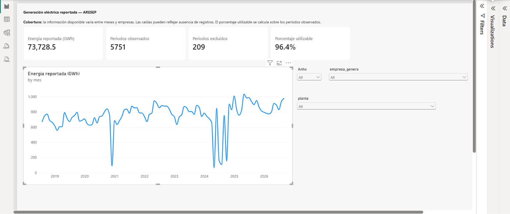

# Reporte de generación eléctrica de ARESEP

El reporte permite consultar la energía mensual reportada por ARESEP, filtrar por año, empresa y planta, y revisar qué proporción de los períodos observados aporta un valor de energía al total.



## Archivos

- [aresep_generacion.pbix](aresep_generacion.pbix): reporte y modelo de Power BI Desktop, con una copia importada de los datos.
- [capturas/resumen.png](capturas/resumen.png): referencia visual del reporte sin filtros de año, empresa o planta.

Power BI consume el modelo analítico de PostgreSQL construido por dbt. MinIO conserva los archivos y snapshots del pipeline; este reporte consulta PostgreSQL.

## Abrir y actualizar

Abrir `aresep_generacion.pbix` en Power BI Desktop. Para actualizar los datos, la instalación local utiliza:

| Configuración | Valor |
| --- | --- |
| Conector | PostgreSQL database |
| Servidor desde Windows | `127.0.0.1:5433` |
| Base de datos | `ice_data` |
| Relación de origen | `dbt_dev_mart.mart_generacion_mensual_planta` |
| Nombre de la tabla en Power BI | `Generacion` |
| Modo de conexión | Import |

Los valores de servidor, puerto y base deben ajustarse si se utiliza otra instalación. Configurar la conexión y las credenciales locales desde **File → Options and settings → Data source settings**. Power BI no lee automáticamente los archivos `.env` del proyecto. Se utiliza la contraseña vigente del usuario de PostgreSQL.

La actualización sigue este orden:

1. Mantener PostgreSQL y los servicios necesarios del pipeline en ejecución.
2. Ejecutar el DAG `generacion_electrica_aresep` en Airflow y comprobar que la transformación con dbt terminó correctamente.
3. En Power BI Desktop, seleccionar **Home → Refresh** para importar los datos actualizados.
4. Guardar el archivo `.pbix`.

Una ejecución de Airflow no actualiza por sí sola la copia importada en Power BI. El archivo guardado permite consultar esa copia; la actualización requiere acceso al origen. Esta versión documenta el uso local en Desktop.

## Modelo de datos

Cada fila de `Generacion` representa una combinación de **empresa, planta y mes observado**. El nombre de una planta debe interpretarse dentro de su empresa.

| Columna | Significado y tipo |
| --- | --- |
| `mes` | Primer día del mes reportado; Date. |
| `empresa_genera` | Empresa generadora; Text. |
| `planta` | Planta reportada; Text. |
| `registros_periodo` | Cantidad de contenidos distintos recibidos para esa empresa, planta y mes; Whole number. |
| `energia_total` | Suma de punta, valle y noche cuando el período es único y completo; Decimal number, admite nulos. |
| `estado_periodo` | `UNICO`, `MULTIPLES_REGISTROS` o `SIN_ENERGIA_COMPLETA`; Text. |

dbt conserva la energía como nula cuando hay varios contenidos para el mismo período o falta alguna de las tres mediciones. Los ceros de energía sí son valores válidos. No reemplazar los nulos por cero en Power Query.

La relación activa es de uno a muchos: `Calendario[Date]` (1) con `Generacion[mes]` (*), con dirección de filtro **Single**, desde Calendario hacia Generacion. Ambas columnas deben tener tipo Date.

### Tabla Calendario

La tabla calculada cubre años completos a partir del rango importado:

```dax
Calendario =
VAR FechaInicial =
    DATE ( YEAR ( MIN ( Generacion[mes] ) ), 1, 1 )
VAR FechaFinal =
    DATE ( YEAR ( MAX ( Generacion[mes] ) ), 12, 31 )
RETURN
    ADDCOLUMNS (
        CALENDAR ( FechaInicial, FechaFinal ),
        "Anho", YEAR ( [Date] ),
        "MesNumero", MONTH ( [Date] ),
        "Mes", FORMAT ( [Date], "mmmm", "es-CR" ),
        "AnhoMes", FORMAT ( [Date], "yyyy-MM" ),
        "AnhoMesOrden", YEAR ( [Date] ) * 100 + MONTH ( [Date] )
    )
```

Marcar `Calendario` como tabla de fechas usando `Date`. Ordenar `Mes` por `MesNumero` y `AnhoMes` por `AnhoMesOrden`.

### Medidas DAX

Crear cada medida por separado mediante clic derecho sobre `Generacion` en el panel **Data → New measure**.

```dax
Energia reportada =
SUM ( Generacion[energia_total] )
```

```dax
Energia reportada (GWh) =
DIVIDE ( [Energia reportada], 1000000 )
```

```dax
Periodos observados =
COALESCE ( COUNTROWS ( Generacion ), 0 )
```

```dax
Periodos con energia =
COALESCE ( COUNT ( Generacion[energia_total] ), 0 )
```

```dax
Periodos excluidos =
[Periodos observados] - [Periodos con energia]
```

```dax
Porcentaje utilizable =
DIVIDE ( [Periodos con energia], [Periodos observados] )
```

El porcentaje se formatea como **Percentage**, con un decimal. Las medidas de conteo se muestran como enteros. `COUNT(energia_total)` incluye los ceros y excluye los nulos. Si no existen períodos observados para una selección, `DIVIDE` devuelve un valor en blanco.

## Unidad de energía

El reporte interpreta los valores originales como **kWh** y los convierte a **GWh** dividiendo entre **1 000 000**. La medida original conserva el valor de origen y la medida en GWh realiza la conversión numérica.

La ficha pública y los metadatos consultados de la API no declaran explícitamente la unidad de `energiaPunta`, `energiaValle` y `energiaNoche`. La escala se corroboró mediante una conciliación independiente: las sumas anuales de esos campos para las diez plantas de CNFL, en 2020 y 2024, coinciden con sus estadísticas oficiales en GWh al dividir entre un millón, dentro del redondeo de las cifras publicadas.

Por ejemplo, para Balsa Inferior en 2024, la API suma **107 637 953,706** unidades originales. La conversión produce **107,637953706 GWh**, frente a **107,63795370665885 GWh** en la estadística de CNFL. Esta es la evidencia utilizada para inferir la unidad original; no se presenta como una declaración de unidad contenida en los metadatos de ARESEP.

Fuentes de la comprobación:

- [Ficha del conjunto de ARESEP](https://aresep.go.cr/datos-abiertos/generacion-fuente-planta-capacidad-instalada/).
- [Respuesta de la API para 2020](https://datos.aresep.go.cr/ws.datosabiertos/Services/IE/Electricidad.svc/ObtenerGeneracionFuentePlantaYCapacidadInstalada/2020).
- [Respuesta de la API para 2024](https://datos.aresep.go.cr/ws.datosabiertos/Services/IE/Electricidad.svc/ObtenerGeneracionFuentePlantaYCapacidadInstalada/2024).
- [Estadísticas de consumo y generación de CNFL, hoja Generación](https://www.cnfl.go.cr/contenido/documentos/transparencia/informacion-institucional/estadisticas_consumo_energia-2025.xlsx), enlazadas desde su [portal de datos abiertos](https://www.cnfl.go.cr/transparencia/datos-abiertos-de-gobierno).

## Configuración de los visuales

| Visual | Configuración |
| --- | --- |
| Tarjetas | `Energia reportada (GWh)`, `Periodos observados`, `Periodos excluidos` y `Porcentaje utilizable`. |
| Gráfico de líneas, eje X | `Generacion[mes]`, fecha simple, eje continuo y orden cronológico ascendente. |
| Gráfico de líneas, eje Y | `Energia reportada (GWh)`, con Display units en None. |
| Filtro de año | `Calendario[Anho]`, Slicer de tipo Dropdown. |
| Filtro de empresa | `Generacion[empresa_genera]`, Slicer de tipo Dropdown. |
| Filtro de planta | `Generacion[planta]`, Slicer de tipo Dropdown. |

El título del gráfico y el de la tarjeta identifican la unidad GWh. La tarjeta suma todos los períodos incluidos en los filtros; el gráfico muestra el total por mes. Que el eje continuo muestre etiquetas anuales no cambia la agregación mensual de los puntos.

En la tarjeta de energía, configurar **Format visual → Visual → Callout → Cards: Energia reportada (GWh) → Value → Display units: None**. Seleccionar la tarjeta individual permite acceder a su formato numérico. La captura utiliza un decimal.

En el gráfico, configurar **Visual → Y-axis → Values → Display units: None**, con cero decimales para las etiquetas del eje. La medida ya está convertida: dejar Display units en Millions mostraría los GWh en millones de GWh, con etiquetas como `0.0010M` en lugar de `1000`.

## Interpretación y cobertura

- **Períodos observados** cuenta combinaciones empresa–planta–mes recibidas. No cuenta meses únicos ni períodos esperados de un catálogo completo.
- **Períodos excluidos** cuenta las combinaciones observadas cuya energía es nula por ambigüedad o por mediciones incompletas.
- **Porcentaje utilizable** divide los períodos observados con energía por todos los períodos observados. No mide el porcentaje de generación nacional representada ni la cobertura de registros que debieron llegar.
- La suma de energía corresponde a los registros utilizables disponibles. No debe interpretarse automáticamente como generación nacional completa.
- Las ausencias de empresas o plantas pueden producir caídas en la serie. No se imputan valores para cubrir esos faltantes.
- En el histórico usado para la captura, 2018 comienza en agosto y 2026 llega a septiembre. Evitar comparar esos totales anuales parciales con años completos sin ajustar el rango de meses y revisar la cobertura.

La revisión independiente de las respuestas actuales de la API encontró 55 períodos empresa–planta–mes en noviembre de 2020 y 16 en diciembre. Para abril de 2024 encontró 64, frente a 32 en mayo. En diciembre de 2020 y mayo de 2024 no aparecen registros del ICE. Estos resultados explican por qué una caída del total reportado no demuestra, por sí sola, una caída equivalente de la generación física. La revisión de la API es independiente de la copia importada en el PBIX.

La página incluye la siguiente nota:

> Cobertura: la información disponible varía entre meses y empresas. Las caídas pueden reflejar ausencia de registros. El porcentaje utilizable se calcula sobre los períodos observados.

## Referencia de la captura

Con los filtros en All, la captura incluida muestra:

| Indicador | Valor mostrado |
| --- | ---: |
| Energía reportada | 73 728,5 GWh |
| Períodos observados | 5 751 |
| Períodos excluidos | 209 |
| Porcentaje utilizable | 96,4 % |

Son valores de referencia de esa carga y están redondeados según el formato del visual. Pueden cambiar al actualizar o filtrar el reporte; no son constantes incorporadas en las medidas.

## Documentación relacionada

- [Modelos y pruebas de dbt](../dbt/README.md).
- [Actualización de datos en Power BI](https://learn.microsoft.com/en-us/power-bi/connect-data/refresh-data).
- [Formato numérico y unidades de visualización](https://learn.microsoft.com/en-us/power-bi/create-reports/desktop-custom-format-strings).
